# Flap

A Flappy Bird–inspired arcade game that lives entirely in your terminal and
is played over SSH. Nothing to install: if you have `ssh`, you can play.

```sh
ssh -p 2222 flappy@game.example.com
```

<p align="center">
  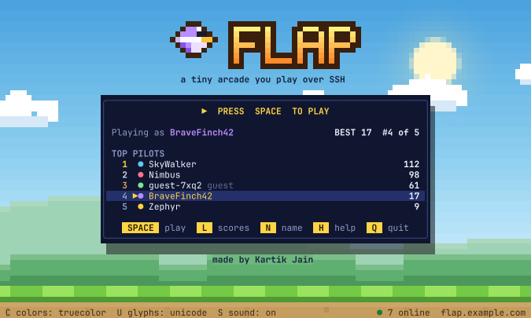
  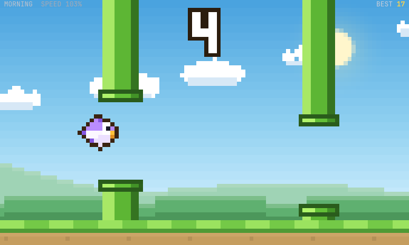
</p>
<p align="center">
  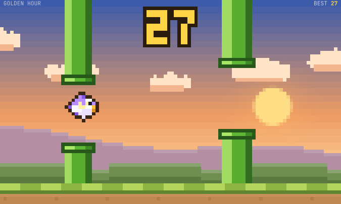
  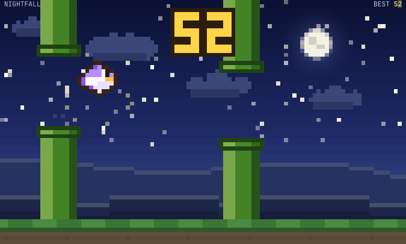
  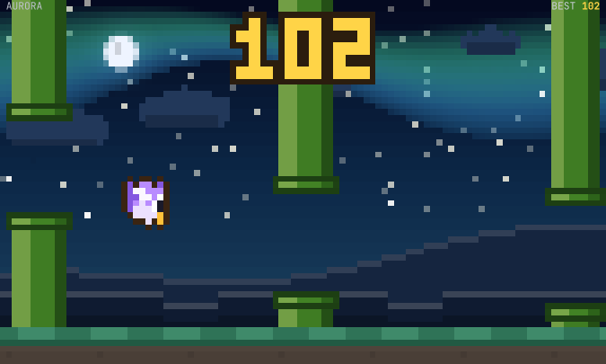
  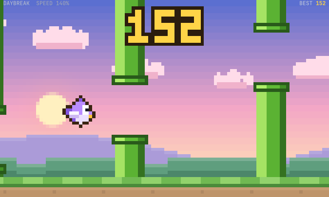
</p>
<p align="center">
  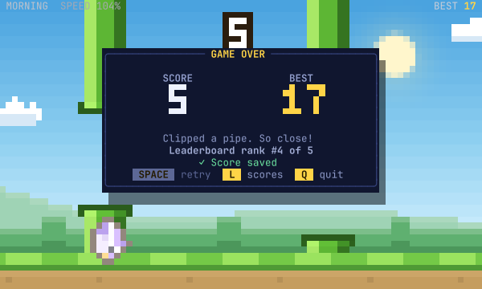
  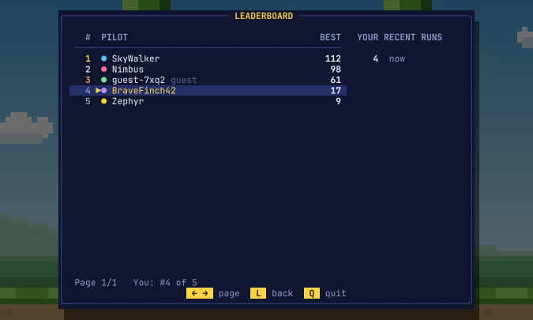
</p>

The game runs on the server. The client only sends key presses and receives
a cell-diffed stream of terminal updates, so scores are computed server-side
and cannot be submitted by clients.

## Features

- **Original pixel-art look using terminal cells.** Half-block pixels give
  square pixels and twice the vertical resolution. The scene has a cached sky
  gradient, sun, moon, stars and aurora, parallax clouds and hills, shaded
  pipes, a scrolling ground and a procedurally rasterised bird that tilts and
  flaps. Each player gets their own bird colour.
- **Difficulty that keeps rising.** Speed, gap size and pipe spacing tighten
  a little with every point instead of jumping between levels. The HUD shows
  the current speed (100% at the start, 140% from 150 points). Six
  time-of-day stages (Morning, Midday, Golden Hour, Nightfall, Aurora,
  Daybreak) change the sky at 10, 25, 50, 100 and 150 points, and a banner
  announces each speed-up.
- **Sound effects through the terminal bell.** It rings when the game speeds
  up, when you beat your personal best mid-run, and when you crash. Toggle it
  with <kbd>S</kbd>; the setting is remembered. The bell is the only sound a
  terminal can make on every platform (Windows Terminal, the Windows
  console, Linux and macOS terminals), so it is one system "ding" rather than
  distinct sounds. A terminal set to a visual bell flashes instead.
- **Adapts to any terminal size.** Physics run in normalised world units, so a
  resize never changes the game state. The layout rescales, very wide or tall
  terminals are letterboxed to keep look-ahead fair, and a run is paused (with
  a 1.5 s countdown on resume) when the window changes size. Below the minimum
  size (50×18 by default) a resize notice appears, and the game resumes once
  the window is big enough.
- **Truecolor, 256 and 16 colours, Unicode or pure-ASCII glyphs.** Modes are
  detected from `TERM`/`COLORTERM`; players switch with <kbd>C</kbd> and
  <kbd>U</kbd>, and the choice is remembered.
- **Persistent identity and leaderboard.** Your SSH public key is your
  account, stored only as a keyed hash. Players without a key can play as
  guests. Scores live in SQLite with atomic, idempotent writes, survive
  restarts, and runs interrupted by quitting, disconnects or shutdowns are
  still saved.
- **Hardened public service.** It is a dedicated SSH server, not sshd. There
  is no shell, no commands, no forwarding and no SFTP. It has connection and
  handshake limits, per-IP rate limits and bans, bounded input and output,
  idle and session timeouts, keepalives, a systemd sandbox (exposure score 1.2
  "OK") and structured logs with IP minimisation.

| Compact (50×18) | ASCII mode | 16 colours | Too small |
|---|---|---|---|
| 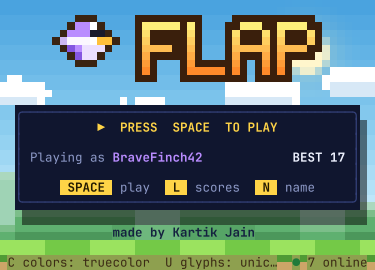 | 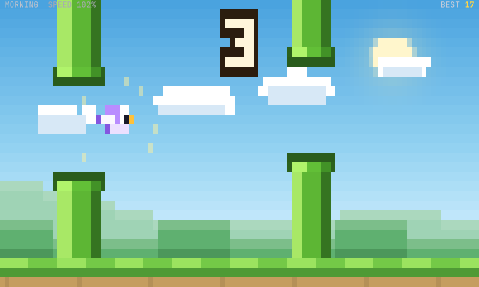 | 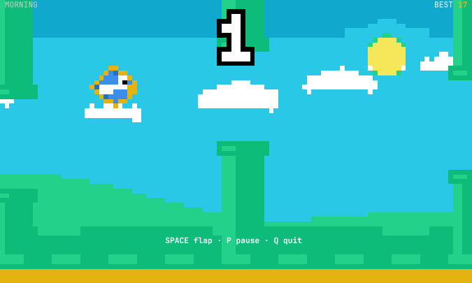 | 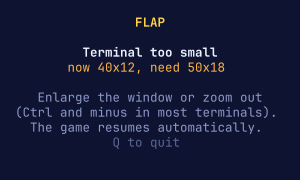 |

## Controls

| Key | Action |
|---|---|
| <kbd>Space</kbd> (or <kbd>↑</kbd>) | Start, flap, resume, retry |
| <kbd>P</kbd> | Pause / resume |
| <kbd>L</kbd> | Leaderboard (<kbd>←</kbd>/<kbd>→</kbd> to page) |
| <kbd>N</kbd> | Change your name (players with an SSH key) |
| <kbd>C</kbd> | Cycle colours: truecolor → 256 → 16 |
| <kbd>U</kbd> | Toggle Unicode / ASCII graphics |
| <kbd>S</kbd> | Sound effects on / off (terminal bell) |
| <kbd>H</kbd> or <kbd>?</kbd> | Help |
| <kbd>Q</kbd>, <kbd>Esc</kbd>, <kbd>Ctrl</kbd>+<kbd>C</kbd> | Quit (on the leaderboard and help screens <kbd>Esc</kbd> goes back) |

No key needs <kbd>Enter</kbd>. After a crash <kbd>Space</kbd> is ignored for
0.6 s, so frantic flapping does not instantly restart.

## Playing

### Connect

Windows 10/11 ship the OpenSSH client; use Windows Terminal or PowerShell.

```powershell
# Windows PowerShell
ssh -p 2222 flappy@YOUR_VPS_IP
```

```sh
# Linux or macOS
ssh -p 2222 flappy@YOUR_VPS_IP
```

The user name is ignored, so any name works. On the first connection your
client shows the server's host key fingerprint. Compare it with the one the
operator publishes (`flapd fingerprint`) before typing `yes`. The client
remembers it as `[YOUR_VPS_IP]:2222` in `known_hosts`, separately from
port 22.

### Keep your scores: use an SSH key

Your public key is your identity. Without a key you play as a guest. Guest
scores do appear on the leaderboard (unless the operator disables that), but
the guest name can't be changed or reused on your next connection.

```sh
ssh-keygen -t ed25519 -f ~/.ssh/flap_ed25519 -C flap          # Linux / macOS
ssh-keygen -t ed25519 -f $HOME\.ssh\flap_ed25519 -C flap      # Windows PowerShell

ssh -i ~/.ssh/flap_ed25519 -o IdentitiesOnly=yes -p 2222 flappy@YOUR_VPS_IP
```

`IdentitiesOnly=yes` makes the client always offer the same key. Without it,
an SSH agent holding several keys may offer a different one first, which
shows up as a different player. For convenience, add this to `~/.ssh/config`:

```
Host flap
    HostName YOUR_VPS_IP
    Port 2222
    User flappy
    IdentityFile ~/.ssh/flap_ed25519
    IdentitiesOnly yes
```

and then just run `ssh flap`. Accepted key types are Ed25519, ECDSA,
FIDO/security keys, and RSA of 2048 bits or more.

### Terminal tips

- Terminals of at least 80×24 look best; the minimum is 50×18.
- Colours look off (for example on macOS Terminal): press <kbd>C</kbd>.
- Boxes or blocks look broken (legacy consoles, CJK "ambiguous width" fonts):
  press <kbd>U</kbd> for ASCII mode.
- No sound? The game uses your terminal's bell. In Windows Terminal it is
  audible by default (`bellStyle`). On Linux and macOS check the terminal's
  bell setting, and note that tmux and screen only pass bells through when
  configured to.
- If the network drops mid-game, the server can't restore your terminal.
  Run `reset` (Linux or macOS) or open a new tab (Windows).

## Running a server

The short version, for a Debian or Ubuntu VPS with systemd:

```sh
make build                      # on any machine with Go 1.26+; static binary in bin/
rsync -a --exclude .git ./ you@vps:flap/
ssh you@vps 'cd flap && sudo ./deploy/install.sh'
sudo ufw allow 2222/tcp         # the installer never touches your firewall
```

`install.sh` creates an unprivileged `flapd` user, installs the binary,
config, host key and hardened systemd unit, checks that the port is free, and
starts and health-checks the service. On upgrades it backs up the database,
keeps the previous binary, and rolls back automatically if the new version
fails its health check. It never modifies sshd, firewall rules or other
services, and it refuses port 22 unless told otherwise.

[docs/OPERATIONS.md](docs/OPERATIONS.md) covers the full deployment
walkthrough, configuration changes, logs, backup and restore, upgrade and
rollback, uninstalling, maintenance mode and troubleshooting.

### Try it locally

```sh
make build
./bin/flapd play                              # play in this terminal, no SSH involved

# or run the real server on localhost:
sed -e 's|0.0.0.0:2222|127.0.0.1:2222|' -e "s|/var/lib/flapd|$PWD/dev-state|g" deploy/flapd.toml > dev.toml
./bin/flapd serve -config dev.toml
ssh -p 2222 -o StrictHostKeyChecking=accept-new flappy@127.0.0.1
```

## Configuration

All settings live in one TOML file (`/etc/flapd/flapd.toml`).
[`deploy/flapd.toml`](deploy/flapd.toml) documents every key with its
default; a test checks that this file matches the built-in defaults. Missing
keys fall back to secure defaults, unknown keys are errors, and every value is
range-checked at startup, with all problems reported at once. Run
`flapd check-config -config FILE` after editing.

| Section | What it controls |
|---|---|
| `[server]` | Listen address/port (default `0.0.0.0:2222`), host key files, identity secret, displayed server name, maintenance mode and message, shutdown grace period |
| `[auth]` | `open` (keys + guests, default), `publickey` (keys only) or `allowlist` (authorised keys file, reloaded on SIGHUP); whether guests are ranked |
| `[limits]` | Max connections (64), handshakes (16), games (20), per IP (3), per key (2); connection rates per IP and globally; failed-auth bans; handshake, session-start, idle (10 min), max session (2 h) and write (20 s) timeouts; keepalives; input rate; max PTY size |
| `[ui]` | Gameplay and menu frame rates, minimum terminal size, default colour, glyph and sound modes |
| `[game]` | Simulation tick rate, gravity, flap strength, pipe geometry, smooth or stepped difficulty, and the difficulty stages. Curves that would make gaps unreachable (including interpolated steps) are rejected. |
| `[storage]` | Database path, operation timeout, leaderboard size, run history retention, guest retention, startup integrity check |
| `[logging]` | Level, JSON or text format, how client IPs are logged (`full`, `truncated`, `hashed`, `none`), periodic resource stats |

## High scores and persistence

- The leaderboard ranks each player's best score; ties go to whoever reached
  it first. A player's rank, run count and recent runs are shown in the game.
- The server records each run: score, duration, flaps, course seed, end reason
  and timestamp. Each run write happens in one IMMEDIATE transaction with the
  personal-best update, under a unique run ID, so a retried save is never
  counted twice. The database runs WAL with `synchronous=FULL`.
- If the database is briefly unavailable the game keeps running. Saves are
  retried, the game-over card says whether the score was saved, and a pending
  run is saved again when the session ends.
- Retention is configurable. Old run history is pruned (365 days and 500 runs
  per player by default), and idle guests below the leaderboard are removed
  after 30 days. Bests live on the player record, so pruning never changes the
  leaderboard.

## Security

The full threat model is in [docs/SECURITY.md](docs/SECURITY.md). In short:

- flapd is its own SSH server built on `golang.org/x/crypto/ssh`. It accepts
  exactly one `session` channel with a PTY and a `shell` request, and that
  request starts the game. `exec`, subsystems (SFTP/SCP), port forwarding,
  agent and X11 forwarding, extra channels and all global requests are
  refused. It has no code path that runs a command.
- Passwords are never offered. Identity comes from proof of possession of a
  private key, never from the SSH user name. The stored identity is
  HMAC-SHA256(server secret, public key), so a leaked database can't be
  matched against public key directories.
- Display names are restricted to `[A-Za-z0-9._-]`, 3–16 characters,
  look-alike-unique and screened for reserved names. Independently, every
  rune sent to a terminal passes a filter that blocks control characters,
  escape sequences, bidi overrides and zero-width tricks.
- Limits apply before any cryptography, so an abusive client costs a socket
  and little else. Measured: a burst of 300 simultaneous connections caused
  no growth in memory, file descriptors or threads.
- Under systemd the service runs as `flapd` with no capabilities, no new
  privileges, a read-only filesystem except `/var/lib/flapd`, a syscall
  filter, and memory, CPU, task and file limits.

Realistic limits: SSH proves that a player holds a key, not who they are.
Anyone can make new keys or play as a guest, and a sufficiently clever bot
could play well. See the threat model for details.

## Performance

These are measurements on the development machine (Ryzen 5 5600X), with
flapload driving real SSH sessions against the static binary in 256-colour
mode:

| Scenario | CPU (one core) | RSS | Output per player | Result |
|---|---|---|---|---|
| idle server | 0% | 17 MB | – | |
| 20 players, 100×30 | 32–42% | ~80 MB | ~54 KB/s avg (96 KB/s while flying) | 0 failures, connect p50 37 ms |
| 20 players, 160×50 | 48–63% | ~150 MB | ~85 KB/s avg | 0 failures |
| churn: 15 players reconnecting every 2 s, 30 s | ~21% | 48 MB, flat | | 221 sessions, 0 failures, fds back to baseline |
| burst: 300 connections at once | – | flat | | 17 games, 283 refused by limits, no growth |

Database latency with 5,000 players and 20,000 runs (`go test ./internal/store
-bench .`): saving a run takes 0.86 ms (including an fsync, because
`synchronous=FULL`), a leaderboard page 0.33 ms, and a player's rank 0.73 ms.

Gameplay runs at up to 30 FPS. Larger terminals drop to a minimum of 18 FPS
to keep bandwidth near 100 KB/s per player, while the simulation stays at a
fixed 60 Hz. A test enforces the bandwidth budget. Lowering `ui.render_fps`
trades smoothness for bandwidth. See [docs/ARCHITECTURE.md](docs/ARCHITECTURE.md)
for how rendering is kept cheap.

## Development

```sh
make build        # bin/flapd and bin/flapload (static, CGO_ENABLED=0, -trimpath)
make test         # unit + integration tests (real SSH sessions on loopback)
make race         # the same with the race detector
make lint vuln    # staticcheck and govulncheck at pinned versions
make shellcheck   # deployment scripts (Docker)
make deploy-test  # install/upgrade/rollback/uninstall on Debian 12 and Ubuntu 24.04 under systemd (Docker)
make shots        # regenerate the screenshots (ImageMagick)
./bin/flapload -addr 127.0.0.1:2222 -n 20 -duration 60s -pid "$(pidof flapd)"   # load test; never against servers you don't own
```

### Layout

```
cmd/flapd/            server binary: serve, init, check-config, keygen, fingerprint, check-db, backup, healthcheck, play
cmd/flapload/         bounded load generator
internal/game/        deterministic simulation: physics, pipes, collisions, scoring, difficulty
internal/canvas/      cell grid, half-block pixels, safe text, ANSI encoder and colour quantisation
internal/tui/         Bubble Tea model: screens, layout, scene rendering, input
internal/sshserver/   SSH protocol policy, admission control, sessions, host keys, identity
internal/store/       SQLite persistence, migrations, leaderboard, retention, backup
internal/security/    name rules, token buckets, per-IP admission, IP redaction
internal/config/      configuration loading and validation
internal/sdnotify/    systemd readiness notification
deploy/               systemd unit, sample config, install/uninstall/rollback scripts, container test
docs/                 architecture, security model, operations guide, screenshots
```

### Stack and design decisions

- **Go** builds a single static binary with no runtime dependencies, has
  strong SSH and concurrency libraries, and keeps per-session overhead low.
- **`golang.org/x/crypto/ssh` directly**, rather than a framework such as
  wish/gliderlabs. The server has to make every policy decision itself (which
  channels and requests exist, timeouts, limits), and doing it directly keeps
  that surface small and explicit.
- **Bubble Tea v2** provides the event loop, the key decoding (including Kitty
  keyboard reports), terminal mode management, and above all its cell-diffing
  renderer. That renderer only sends changed cells, which is what makes a
  full-screen 30 FPS game viable over SSH.
- **A custom canvas instead of Lip Gloss.** A pixel game needs per-cell
  control, half-block compositing and a single sanitising encoder, which a
  layout and styling library doesn't provide. Lip Gloss would have added a
  dependency without removing any of that code.
- **SQLite via `modernc.org/sqlite`.** It is pure Go, so no cgo and no
  database server, and with WAL and IMMEDIATE transactions it is durable and
  concurrent enough for a game leaderboard.
- **A normalised, deterministic simulation.** World height is 1.0 at every
  terminal size, and the RNG is seeded per run with a fixed timestep. Gameplay
  is therefore identical across sizes, resize-safe and fully testable,
  including a bot that plays through 120 ms of simulated SSH latency.

## Testing status

These were run on the development machine:

- All unit and integration tests, with and without `-race`.
- staticcheck, govulncheck (clean; see below) and shellcheck.
- End-to-end runs with the real OpenSSH 10.5 client in tmux: play, live
  resize, quit, terminal restoration, and refusal of exec, `-T`, `-L`, `-R`,
  `-A`/`-X`, scp, sftp and password-only clients.
- The deployment test under systemd on Debian 12 and Ubuntu 24.04.
- The load tests above.

govulncheck reports nothing reachable. It notes that `golang.org/x/crypto`
contains the deprecated `openpgp` package, which flapd does not import.

**Not tested here:** Windows (Windows Terminal, PowerShell, conhost with Win32
OpenSSH), macOS Terminal and iTerm2, PuTTY, and real VPS deployments. The
server sends standard VT sequences and always emits CR LF newlines, which
these clients handle. [docs/OPERATIONS.md](docs/OPERATIONS.md#client-compatibility-checklist)
has a manual checklist for them.

## Credits

Flap is designed and developed by
[Kartik Jain](https://github.com/KartikJain14). The game also credits its
developer on the welcome screen and in the in-game help.

## License

No license has been chosen yet; add one before publishing.
